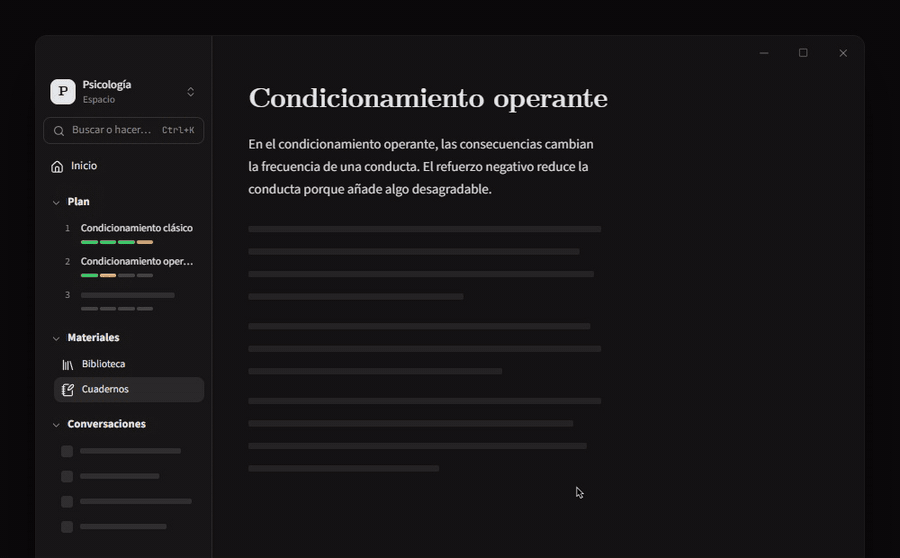

# HarnessAcademico

**Una aplicación de escritorio para estudiar en la que el tutor de IA critica lo que produces, en lugar de producirlo por ti.**

[English](README.md) · [Descargar](https://github.com/dpalazon-dev/harness-academico/releases/latest) · [Primeros pasos](docs/primeros-pasos.md) · [Primer uso](docs/first-run.md) · [Contribuir](CONTRIBUTING.md) · [Discussions](https://github.com/dpalazon-dev/harness-academico/discussions)



¿Primera vez? [Primeros pasos](docs/primeros-pasos.md) recorre el primer uso en cinco pasos animados, del instalador a tu primera práctica ([vídeo completo](docs/assets/primeros-pasos/primeros-pasos.mp4), 86 s).

HarnessAcademico organiza el estudio alrededor de lo que quieres poder *hacer*. Cada materia es un plan de unidades; cada unidad nombra una capacidad y el criterio observable que demuestra que la tienes. Tú escribes primero (lo que ya sabes, tus notas de una fuente, tu reconstrucción sin mirar) y el tutor contrasta, pregunta y señala huecos. La práctica y los repasos espaciados salen de esa evidencia, no de tarjetas que no has escrito.

Es una versión modificada de [LearnHarness](https://github.com/amosblomqvist/learnharness) 0.6.0, de Amos Blomqvist, con la misma licencia AGPL-3.0-only. La interfaz está en español. Créditos y licencias en [NOTICE.md](NOTICE.md).

## Qué hace

- **Espacios, planes y unidades.** Un espacio por materia, con su plan, sus unidades, sus documentos, sus cuadernos y sus conversaciones. El tutor puede proponer cambios del plan o unidades nuevas; nada cambia hasta que lo confirmas.
- **Un ciclo, no una cadena de fases.** Volcado inicial antes de leer, captura desde las fuentes, reconstrucción sin la fuente, contraste y reparación, uso y recuperación espaciada. La app propone el siguiente paso con su motivo en una frase y nunca bloquea los demás.
- **Práctica que cuenta como evidencia.** Un intento es confianza declarada, respuesta sin fuente, contraste y autoevaluación. La respuesta se congela antes de ver la referencia. Los intervalos de repaso salen de esos intentos.
- **Biblioteca.** Adjunta PDF y léelos por páginas, con notas que conservan su localizador.
- **Cuadernos.** Escribes con tus palabras; el tutor anota al margen, dibuja un diagrama Mermaid si se lo pides y ofrece preguntas de recuperación o hechos que solo entran en tu cuaderno si los aceptas. Un modo proactivo decide si comenta por su cuenta. Los comentarios se pueden escuchar, solo con voces locales de Windows.
- **Base de conocimiento.** Los hechos confirmados, cada uno con su cita, se guardan como archivos de texto en un repositorio git con formato KBOL. Es opcional: lo demás funciona sin ella. Incorporar PDF y validar la base necesitan las herramientas de KBOL y [uv](https://docs.astral.sh/uv/); la app dice qué falta al usarlos.
- **Tus modelos, tus datos.** Usa una clave de API, una suscripción compatible, la CLI de Claude Code o un servicio compatible con OpenAI (también uno local). Tus datos viven en las carpetas que elijas, en JSON y Markdown.

## Instalar (Windows x64)

1. Descarga `HarnessAcademico-<versión>-x64-setup.exe` de [Releases](https://github.com/dpalazon-dev/harness-academico/releases/latest) y ejecútalo. El instalador **no está firmado**: SmartScreen avisará de un editor desconocido; elige *Más información → Ejecutar de todas formas*.
2. Al abrirla por primera vez, la app pregunta dónde guardar tus datos (por defecto `Documentos\HarnessAcademico`) y crea ahí tres carpetas. «Salir» no crea nada.
3. Configura un modelo en *Ajustes* y crea tu primer espacio.

El primer arranque tras instalar puede tardar 30 s o más mientras Windows Defender analiza los archivos nuevos; mientras tanto aparece la ventana *Preparando HarnessAcademico…*. Después tarda unos 3 s.

Detalles, ajustes opcionales y cómo desinstalarla: [docs/first-run.md](docs/first-run.md) (en inglés; la tabla de claves es la misma).

macOS y Linux vienen heredados de LearnHarness, pero no se han compilado ni probado en este fork.

## Privacidad

- Tus datos de estudio se quedan en las carpetas que elegiste. La app no los copia ni los sincroniza.
- Las peticiones al modelo envían al proveedor que configures el contexto que necesita la tarea. Guardar en local no significa procesar sin conexión.
- Las claves de API y las credenciales se guardan en `%APPDATA%\HarnessAcademico`, fuera de tus carpetas de datos.
- No hay telemetría ni actualizaciones automáticas.

## Desde el código

Necesitas Node 26, npm y Git. En PowerShell:

```powershell
npm ci
npm run plugins:setup
npm run dev                                          # terminal 1: servidor en http://localhost:3000
$env:LH_DEV_URL="http://localhost:3000"; npx electron .   # terminal 2: ventana de escritorio
npm test
npm run desktop:dist:win                             # instalador de Windows en dist/ (árbol git limpio)
```

Sin `LH_DATA_DIR`, los datos de desarrollo van a `data/` dentro del repositorio.

La mayor parte del estudio vive en el plugin `estudio` ([plugins/estudio](plugins/estudio)). El vocabulario está en [GLOSSARY.md](GLOSSARY.md) y las diferencias con LearnHarness en [docs/sistema-comun/divergencias.md](docs/sistema-comun/divergencias.md).

## Ayuda

- Fallos: [Issues](https://github.com/dpalazon-dev/harness-academico/issues).
- Preguntas e ideas: [Discussions](https://github.com/dpalazon-dev/harness-academico/discussions).
- Problemas de seguridad: en privado, como explica [SECURITY.md](SECURITY.md).

Se puede escribir en español o en inglés.

## Licencia

[AGPL-3.0-only](LICENSE). Aviso de obra modificada y créditos de terceros: [NOTICE.md](NOTICE.md).
