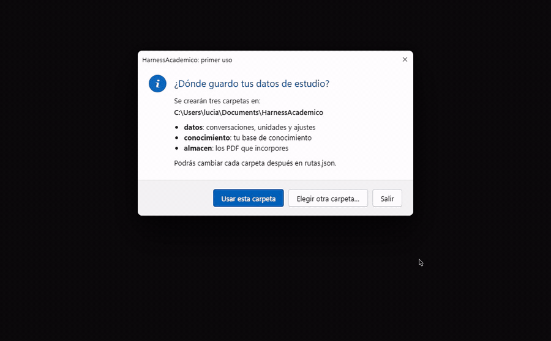
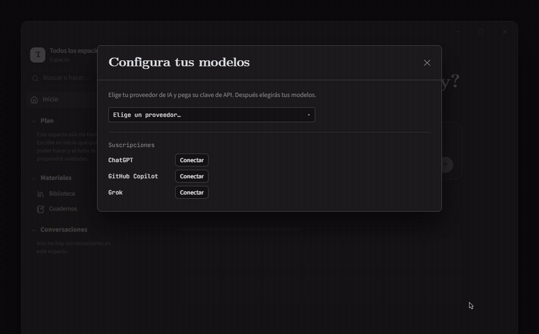
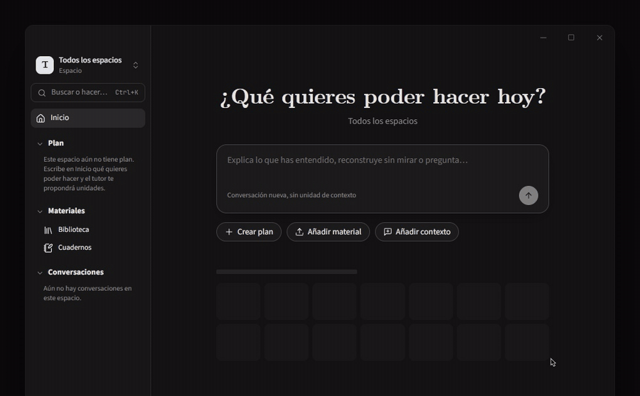
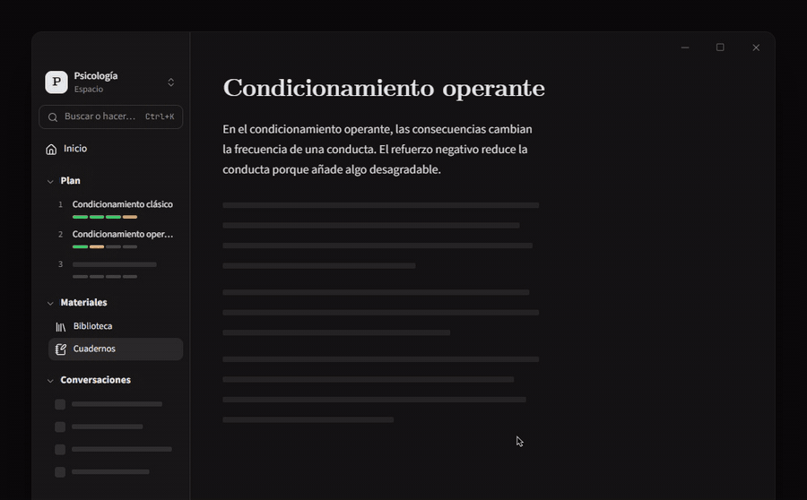
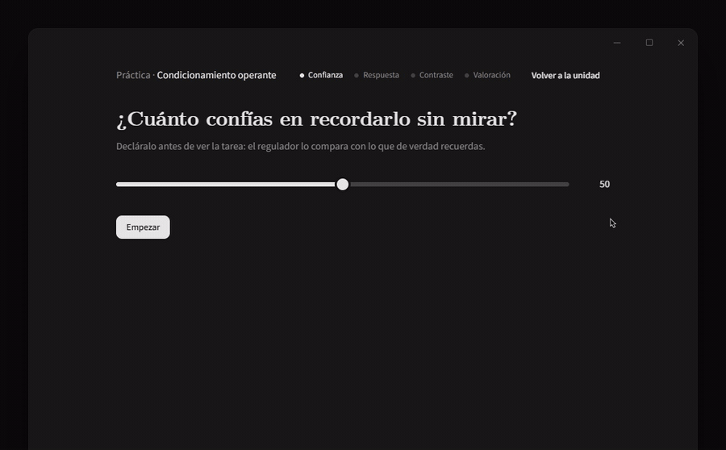

# First steps

[Español](primeros-pasos.md) · [Full video (MP4, 86 s)](assets/primeros-pasos/primeros-pasos.mp4)

From the installer to your first practice attempt, in five steps. The animations are built from the real interface, which is in Spanish; the data is made up. Installation, folders and settings are covered in [First run](first-run.md).

## 1. Choose where your data lives

Download the installer from [Releases](https://github.com/dpalazon-dev/harness-academico/releases/latest) and run it. It is not signed: if SmartScreen warns you, choose **More info → Run anyway**.

On first launch the app asks where to keep your data. The default is `Documents\HarnessAcademico`, where it creates three folders: `datos`, `conocimiento` and `almacen`. Everything stays on your computer. The first launch can be slow while Windows scans the new files.

## 2. Connect a model

The tutor needs an AI model. The same screen offers two ways:

- **A subscription you already pay for:** ChatGPT, GitHub Copilot or Grok. Press **Conectar** and sign in in your browser.
- **An API key** from your provider: Anthropic, OpenAI, Google and others, or an OpenAI-compatible endpoint, including a local one.

If you use [Claude Code](claude-code.md), turn it on in **Ajustes**. Then pick a model for each tier: main, cheap and vision. All three are needed to start a conversation.

## 3. Create a space and its plan

Create one space per subject from the sidebar's space menu. In Inicio, press **Crear plan** and write what you want to be able to do in the end. Then ask the tutor for a route: its units arrive as proposals and only enter the plan once you confirm them in **Por decidir**.

## 4. Write in your own words

In a notebook, you do the writing. Select a sentence and ask the tutor to question you, explain it or draw it. It answers in the margin without touching your text. What it proposes (a retrieval question, a fact for your knowledge base) only enters the page if you accept it.

## 5. Practise without looking

An attempt fills the window, with no sources in sight. Declare your confidence, answer and freeze your answer. Then you see the reference and the model's contrast, and assess your answer. Your reviews are scheduled from that evidence.
