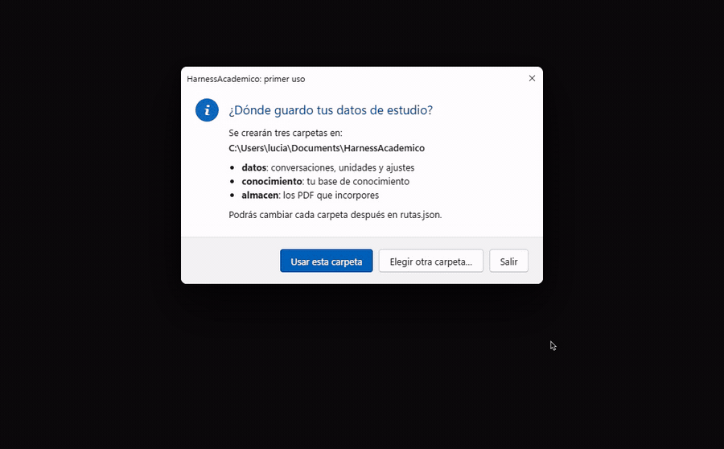
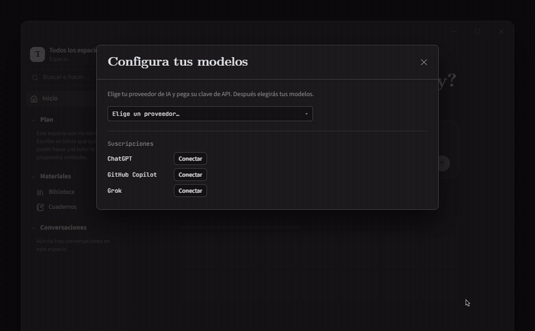
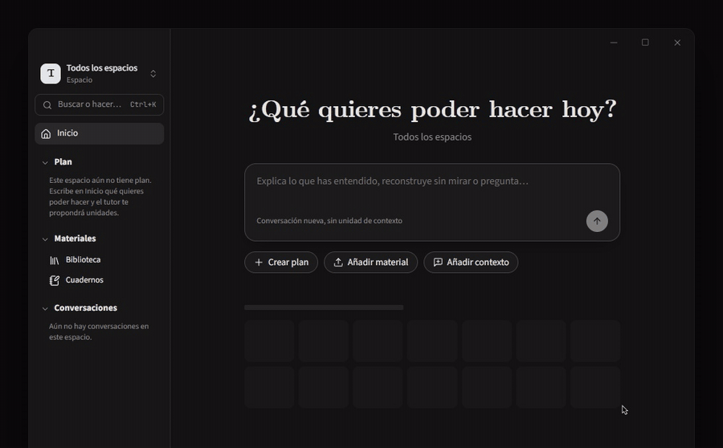
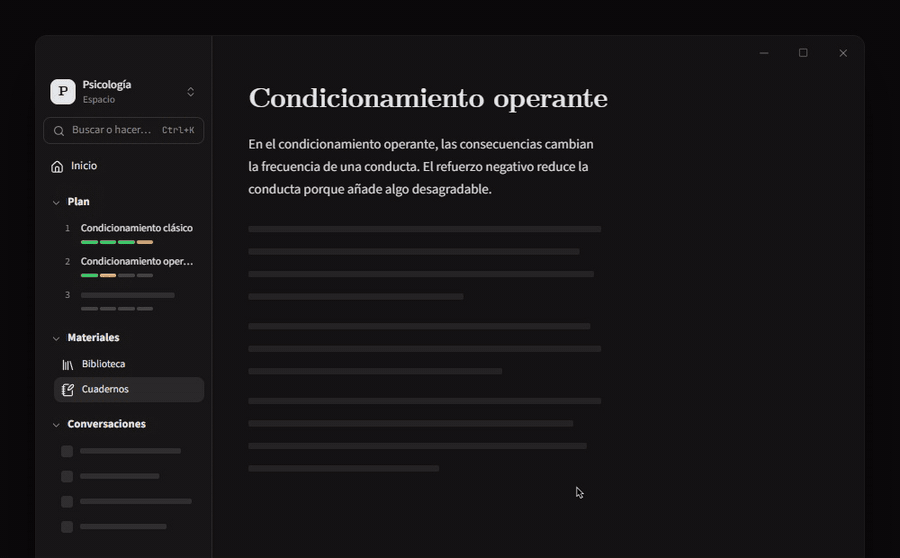
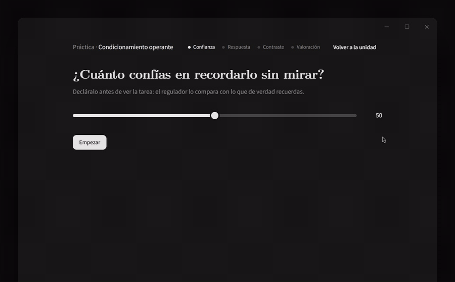

# Primeros pasos

[English](first-steps.md) · [Vídeo completo (MP4, 86 s)](assets/primeros-pasos/primeros-pasos.mp4)

Del instalador a tu primera práctica, en cinco pasos. Las animaciones están hechas a partir de la interfaz real; los datos son de ejemplo. Los detalles de instalación, carpetas y ajustes están en [Primer uso](first-run.md).

## 1. Elige dónde guardar tus datos

Descarga el instalador de [Releases](https://github.com/dpalazon-dev/harness-academico/releases/latest) y ejecútalo. No está firmado: si SmartScreen avisa, elige **Más información → Ejecutar de todas formas**.

Al abrir la app por primera vez, te pregunta dónde guardar tus datos. Por defecto es `Documentos\HarnessAcademico`, donde crea tres carpetas: `datos`, `conocimiento` y `almacen`. Todo queda en tu equipo. El primer arranque puede tardar mientras Windows comprueba los archivos nuevos.

## 2. Conecta un modelo

El tutor necesita un modelo de IA. Tienes dos caminos en la misma pantalla:

- **Una suscripción que ya pagas:** ChatGPT, GitHub Copilot o Grok. Pulsa **Conectar** e inicia sesión en el navegador.
- **Una clave de API** de tu proveedor: Anthropic, OpenAI, Google y otros, o un servicio compatible con OpenAI, también uno local.

> **HarnessAcademico es un agente, no un chat.** Con una suscripción no usa la versión de chat (chatgpt.com, claude.ai), sino el acceso para agentes de tu plan: con ChatGPT gasta el uso de **Codex**; con Claude Code, el de **Claude Code**; con GitHub Copilot y Grok, el de esas cuentas. Cuenta igual que si usaras esas herramientas, con sus límites, y el trabajo en segundo plano también cuenta. Con una clave de API pagas por tokens a tu proveedor.

Si usas [Claude Code](claude-code.md), actívalo en **Ajustes**. Después elige un modelo para cada nivel: principal, económico y visión. Hacen falta los tres para empezar una conversación.

## 3. Crea un espacio y su plan

Crea un espacio por materia desde el menú de la barra lateral. En Inicio, pulsa **Crear plan** y escribe qué quieres poder hacer al final. Después pide al tutor una ruta: sus unidades llegan como propuestas y no entran en el plan hasta que las confirmas en **Por decidir**.

## 4. Escribe con tus palabras

En un cuaderno escribes tú. Selecciona una frase y pide al tutor que te pregunte, te lo explique o lo dibuje. Responde al margen, sin tocar tu texto. Lo que propone (una pregunta de recuperación, un hecho para tu base) solo entra en la página si lo aceptas.

## 5. Practica sin mirar

Un intento ocupa toda la ventana, sin fuentes a la vista. Declara tu confianza, responde y congela la respuesta. Después ves la referencia y el contraste del modelo, y valoras tu respuesta. Con esa evidencia se programan tus repasos.
